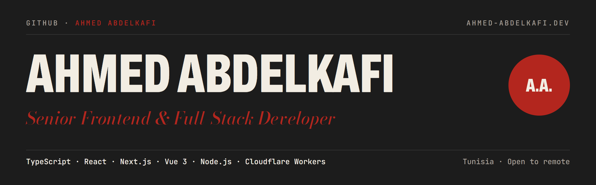

I build web products end to end, from the interface to the API and the database, and ship them to production with tests and CI.
Most of my recent work runs on the Cloudflare edge (Workers, D1, R2, Durable Objects) with React and Next.js on the front end.
**5+ years** of experience · **open to remote roles and freelance missions.**

**[Portfolio](https://ahmed-abdelkafi.dev)** · **[LinkedIn](https://www.linkedin.com/in/ahmed-abdelkafi)** · **[Email](mailto:abdelkafi.ahmed.techsup@gmail.com)**

---

### Selected work

| Project | What it is | Stack |
|---|---|---|
| [**Mister White**](https://github.com/ahmed-abdelkafi/mister-white) · [play](https://mister-white.pages.dev) | Real-time multiplayer party game in EN / FR / AR (RTL). Each room is a Durable Object holding server-authoritative state over WebSockets; 546 word pairs in D1, optional Workers AI pairs; engine tested in CI | React 19, TypeScript, Durable Objects, D1, Workers AI, Vitest |
| [**La Badira**](https://github.com/ahmed-abdelkafi/badira) · [live](https://la-badira.abdelkafi-ahmed-techsup.workers.dev) | Hotel website in FR / EN / AR (RTL) with a staff dashboard: reservations, CMS, roles, mandatory 2FA, live updates and push notifications | Next.js 16, React 19, Drizzle, D1, R2, Vitest |
| [**Portfolio**](https://ahmed-abdelkafi.dev) | Bilingual portfolio with scroll-driven motion and a private admin dashboard: cookie-free first-party analytics, server-side auth, email alerts | Next.js 16, TypeScript, GSAP, Cloudflare Workers, D1 |
| [**Lines Up**](https://linesup-architecture.com) *(client, code private)* | Multilingual website and custom CMS for an architecture studio, built solo: roles, approval workflow, scheduled publishing, 360+ tests, CI | Next.js 16, Cloudflare Workers, D1, R2 |
| [**QRBase**](https://qrbase.xyz) *(code private)* | Gamified platform, 2nd prize at the Base hackathon on Devfolio: Next.js frontend with 50+ reusable components | Next.js, TypeScript, TanStack Query |

### Open source

Contributor to [**OpenNext for Cloudflare**](https://github.com/opennextjs/opennextjs-cloudflare), the adapter that runs Next.js on Cloudflare Workers:

- [#1519](https://github.com/opennextjs/opennextjs-cloudflare/pull/1519) · **fix:** the config validation rejected a valid custom `tagCache` because it checked `incrementalCache` instead. Fixed the check and added the first tests for it.
- [#1513](https://github.com/opennextjs/opennextjs-cloudflare/pull/1513) · **test:** tests that the Node.js middleware bundle keeps `cloudflare:*` imports (e.g. from `postgres`) external, sharing its esbuild resolve options with the spec.

### What I work with

- **Front end:** TypeScript, React, Next.js (App Router), Vue 3, Tailwind CSS, TanStack Query, accessibility, i18n and RTL
- **Back end:** Node.js, NestJS, Express, REST APIs, WebSockets, Zod
- **Data:** PostgreSQL, Drizzle ORM, Supabase, Cloudflare D1
- **Platform:** Cloudflare Workers, D1, R2, Durable Objects, Docker, GitHub Actions, GitLab CI/CD
- **Quality:** Vitest, Jest, React Testing Library, Cypress, code reviews, Agile/Scrum
- **Mobile:** React Native (apps published on Google Play and the App Store)

### Experience highlights

- Led frontend development (React, Next.js, TypeScript) on a climate-tech marketplace, with Stripe subscriptions and analytics dashboards.
- Built CRM, scheduling and online booking modules for an e-health SaaS (Vue 3, React).
- Built NestJS APIs on PostgreSQL for a legal-tech platform, then fixed and retested the findings of its security audit.
- Cut server API requests by 45% with TanStack Query and made dashboard rendering 30% faster.

### Open to

Remote roles as a Senior Frontend or Full-Stack Developer, freelance missions, and open-source work in the Next.js and Cloudflare ecosystem.
